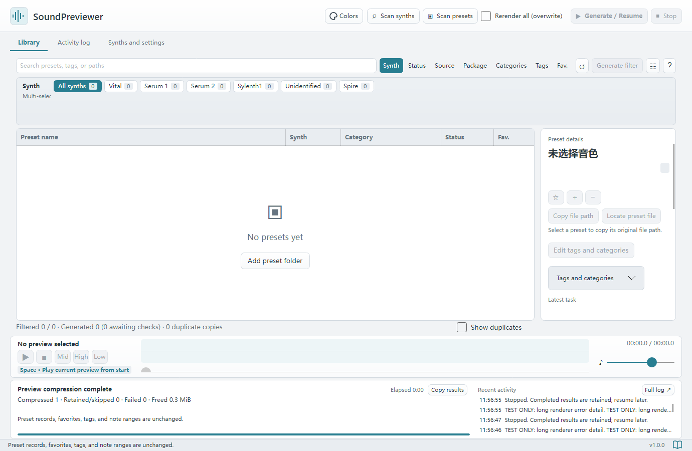

# SoundPreviewer

[简体中文（默认）](README.md) · **English** · [English user guide](UserGuide/en/index.md)

## Support development

## About

Generate short synthesizer preset previews, then search, filter, and audition them in one local library. Existing previews play without opening a DAW or loading the synth.

**Current version: 1.0.1** · Windows x64, macOS Apple Silicon / Intel.

## Features

- Scan mixed preset folders and combine synth, status, source, package, category, tag, and favorite filters.
- Generate Low / Mid / High previews with concurrency, a memory budget, stop / resume, and shared caches for identical content.
- Play WAV / AAC previews, press Space to replay, or audition each note range separately.
- Edit categories, aliases, custom tags, favorites, and feedback; choose Chinese or English with an independent metadata language.
- Keep data locally, back up or move the library, compress old WAV previews, and copy complete generation results for feedback.

Supported preset formats can generate with Vital, Serum 1, Serum 2, and Sylenth1. Spire can be indexed, but native preview generation is not available yet. Supply your own plugins, presets, and licenses.

## Minimum setup and first use

1. **Open:** download your platform package from [GitHub Releases](https://github.com/Reguluz/SoundPreviewer/releases). Install or fully extract the Windows package before opening `SoundPreviewer.exe`. Copy the Mac `.app` into a separate writable folder. The .NET runtime is included.
2. **Configure one synth:** Scan synths, select and link the correct version under Synths and settings → Discovered synths, then check Preview generation and save. Vital uses its standalone program and native mode. For Serum 1 / 2, use Prepare rendering environment. Windows Sylenth1 x86 uses the bundled host.
3. **Scan presets:** add a preset folder under Folders, choose automatic detection for mixed collections, and Scan presets. First launch creates necessary defaults.
4. **Test one:** select a Pending preset, click Regenerate this preset, and compare Mid / High / Low with the synth's original sound. Confirm the match if requested. Fix any reported failure before retrying this preset.
5. **Use daily:** search or filter, then Generate / Resume. Valid previews are skipped and Stop retains finished work. Press Space to audition; use favorites, tags, and categories to organize.

Close the app before upgrading or moving it. Preserve **Preview, Config, categories.json, tags.json**, and custom language files for your personal records and caches.

## Feature Q&A

| Question | Answer |
| --- | --- |
| Can I choose pitches? | **Yes.** Set Low / Mid / High under Playback and storage, using names such as `C4`, `C#4`, or `Db4`. Regenerate existing previews to apply new pitches |
| Can I change duration? | **Yes.** Quick preview supports 0.1–4 seconds per range. Disable it for hold / tail controls; Vital native rendering has additional limits |
| Can I create tags and categories? | **Yes.** Add, rename, select, and edit aliases in Edit tags and categories. Rescanning retains manual choices |
| Can I combine filters and generate only those results? | **Yes.** Multiple selections and combined groups are supported. Generate / Resume uses the current search and filter results |
| Can I stop and resume? | **Yes.** Finished work is retained, valid previews are skipped, and identical content can reuse a cache |
| Is a DAW or synth needed to audition? | **Not for existing previews.** New generation needs the matching local synth and license; initial environment preparation may require internet |
| Can I choose language and WAV / AAC? | **Yes.** Chinese and English are built in; metadata language is independent. Select WAV / AAC for saving or compress existing WAV files |
| Are Spire, FXB banks, and automatic DAW loading supported? | Spire and FXB are currently indexed without direct generation. Automatic DAW track creation / loading is not available; copy the source path and open it manually |

See [detailed feature Q&A](UserGuide/en/quick-start.md#faq) and the [support tables](UserGuide/en/index.md#compatibility).

## Full user guide

The [English Markdown guide](UserGuide/en/index.md) covers configuration, formats, generation, library organization, backup, and troubleshooting. [Simplified Chinese](UserGuide/index.md) is the default edition; every chapter links to its counterpart.

Complete packages include Markdown, local screenshots, and **`SoundPreviewer.chm`** under **`UserGuide`**. The bottom-right book icon opens CHM on Windows or the Chinese Markdown homepage on Mac. CHM defaults to Chinese and includes an English contents group; Markdown readers can follow the English link on the homepage.
