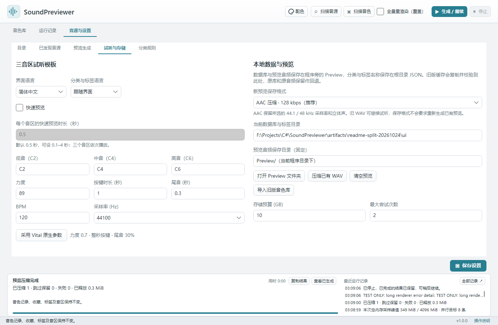
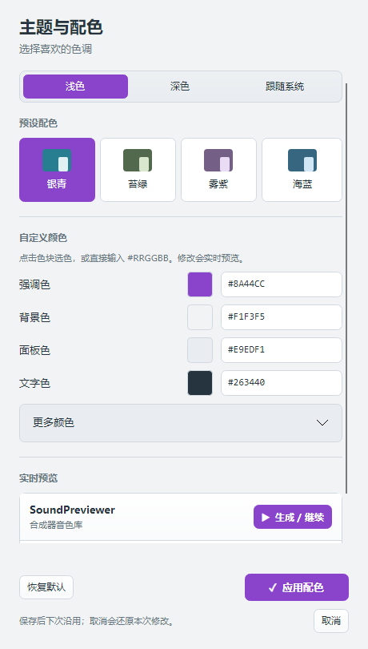

# 语言与外观

本页内容：

- [界面语言与元数据语言](#language)
- [添加界面语言](#translations)
- [分类与标签 JSON](#catalogs)
- [主题与配色](#colors)

## 界面语言与元数据语言

在「音源与设置 → 试听与存储」选择「界面语言」与「分类与标签语言」。后者可以跟随界面，也可单独指定。切换立即生效并保存；音色名称、路径和用户自定义内容保持原样，不会重新生成预览或改变收藏、筛选编号。

## 添加界面语言

界面语言位于程序资源目录的 **`language/zh-CN.json`、`language/en-US.json`**。社区可复制其中一份为 `language/语言编号.json`，将第一个属性 `languageName` 改为选择器中的显示名称，再翻译 `strings` 的值；保留键及 `{1}` 等占位编号。新增文件在重启后出现在列表。Windows 文件夹在 EXE 旁，Mac 资源位于 `.app/Contents/MacOS/language`。

## 分类与标签 JSON

可编辑分类与标签分别位于程序旁的 **`categories.json`、`tags.json`**（Mac 为 `.app` 旁）。退出程序后可编辑 `Items` 内各项的 `Name`、`Aliases` 及 `Languages`：例如 `"Languages":{"en-US":{"Name":"Arp","Aliases":[]}}`。无对应语言时显示该项的默认名称及别名。保留 `CatalogId` 和各项 `Id`，不要改号或复用已有编号；音色通过编号关联，因此改名、增加别名和翻译都不影响匹配。

首次打开旧库会补齐编号，迁移前数据库保存在 `Preview/Backups/before-metadata-ids.db`。库内同时保留分类与标签快照：缺失根目录文件时可恢复；导入另一套库时会按目录身份重新对应编号，避免同号串项。损坏的已有 JSON 会报错并保留原文件。手动编辑后重启读取，升级或整体移动时请一并保留 **Preview、Config、categories.json、tags.json** 及自行添加的语言文件。

## 主题与配色

点击右上角「配色」打开设置。可选浅色、深色或跟随系统，以及银青、苔绿、雾紫、海蓝预设；也可通过 HEX 输入和选色控件修改强调色、背景、面板与文字等颜色。调整时即时预览，点击「应用配色」保存，取消或关闭窗口恢复原配色。「恢复默认」可先预览银青浅色方案，应用后才保存。已有外观选择继续保留。

配色随个人音色库保存在 Preview，更新或搬移时与 Preview 一同保留，不影响音色记录、标签或预览音频。

*在试听与存储页选择界面语言和分类标签语言。点击图片可查看原图。截图使用示例音色库，名称、路径及数值仅用于演示。*

*配色窗口；应用后保存，取消则恢复。点击图片可查看原图。截图使用示例音色库，名称、路径及数值仅用于演示。*

日常分类编辑见[音色库整理](library.md#metadata)；移动程序前按[备份清单](storage.md#backup)保留自定义文件。

---

[操作说明首页](index.md) · [快速开始](quick-start.md) · [安装与启动](installation.md) · [音源配置](synths.md) · [生成与试听](rendering.md) · [音色库整理](library.md) · [数据维护](storage.md) · [语言与外观](appearance.md) · [常见问题](troubleshooting.md)

适用于 SoundPreviewer 1.0.0。正文和截图可离线阅读，外部下载与反馈链接需要联网。
