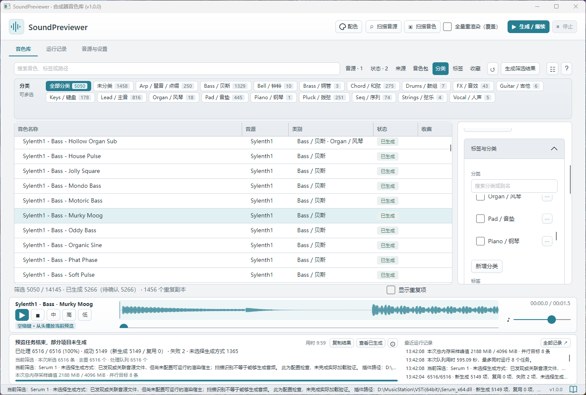

# User guide

[简体中文（默认）](../index.md) · **English**

## Support development

If SoundPreviewer saves you time auditioning presets, you can support future development through the creator's Afdian page using this QR code.

## About SoundPreviewer

SoundPreviewer generates short audio previews of synthesizer presets so you can search, filter, and audition a local library. Playing an existing preview does not require opening a DAW or loading its synth again.

This Markdown guide accompanies **1.0.1**. Windows installer and portable packages also include a compiled CHM manual. Text, screenshots, and chapter links work offline; GitHub, runtime downloads, and technical references require internet access. Chinese is the default guide language, with an equivalent English edition in `UserGuide/en`.

## Main window at a glance

*Click the screenshot to view the original. This user-provided screenshot shows the Chinese interface in 1.0.0 with its preset library, counts, and paths. The English interface has the same layout. Other screenshots use example settings and libraries.*

| Area | What you can do |
| --- | --- |
| Top toolbar and tabs | Scan synths and presets, generate or resume, stop; switch between Library, Activity log, and Synths and settings |
| Search and filters | Search names, tags, and paths; combine Synth, Status, Source, Package, Categories, Tags, and Fav. filters |
| Preset list and details | Select a preset, inspect status and results, mark favorites, edit metadata, regenerate, or locate its source file |
| Player | Press Space to replay; audition Mid / High / Low separately; adjust playback position and volume |
| Task area and bottom-right book icon | Read progress and logs, copy results, or open this guide |

Continue with the [minimum setup and single-preset test](quick-start.md), or return to the [default Chinese guide](../index.md).

## Current support

### Platforms and packages

| Platform | System and architecture | Available packages |
| --- | --- | --- |
| Windows | Windows 10 1809 or later / Windows 11, x64 | `.exe` installer; portable `.zip` |
| macOS, Apple Silicon | macOS 12 or later, M-series chips (arm64) | `.dmg`, `.zip` |
| macOS, Intel | macOS 12 or later, Intel (x64) | `.dmg`, `.zip` |
| Linux / Windows ARM64 | No dedicated release package yet | None |

Minimum systems reflect package configuration, rather than testing on every older OS. See [installation](installation.md). Plugin architecture must also match the rendering environment.

### Synths, plugins, and preset formats

| Synth | Program / plugin used for generation | Preset formats | Current support |
| --- | --- | --- | --- |
| Vital | Standalone Vital | `.vital`; eligible presets inside `.vitalbank` | Generation available; real samples checked on Windows and Apple Silicon; Mac bank generation awaits testing |
| Serum 1 | VST2 | Individual `.fxp` | Generation available; real samples checked on Windows x64; Mac awaits testing |
| Serum 2 | VST3 | Native `.SerumPreset` | Generation available; real samples checked on Apple Silicon; Windows / Intel Mac await testing |
| Sylenth1 | VST2; bundled host for Windows x86 | Individual `.fxp` | Generation available; real samples checked on Windows x86; other combinations await testing |
| Spire | Native generation not available yet | `.spf`, `.spf2`, `.sbf`, `.swzip` | Scan and index only; no preview generation |
| FXB banks | Depends on the synth | `.fxb` | Indexed, but cannot generate directly; export supported individual presets in the synth first |

Supply your own synths, preset files, and licenses. An available rendering path still needs a single-preset check with your plugin version and external resources. See [synth setup and format limits](synths.md#support).

### Interface languages

| Built-in language | Language ID | Coverage |
| --- | --- | --- |
| Simplified Chinese | `zh-CN` | Interface and default category / tag text |
| English | `en-US` | Interface and default category / tag text |

Interface language and metadata language can be selected independently. Original preset names, paths, and custom names are not automatically translated. Community language JSON files can be added; see [language and appearance](appearance.md#language).

## Where to start

- **First use:** [Quick start](quick-start.md) covers minimum setup, one-preset testing, and batch use.
- **Checking for a feature:** [Feature Q&A](quick-start.md#faq) covers preview pitch, custom tags, filters, and resuming.
- **Not installed:** [Installation](installation.md) covers platform packages and writable folders.
- **Changed synth or plugin version:** [Synth setup](synths.md) covers formats, architecture, and rendering paths.
- **Ready for batches:** [Generation and playback](rendering.md) explains templates, scope, memory, statuses, and the player.
- **Finding and marking presets:** [Library organization](library.md) explains folders, filters, metadata, and file paths for DAWs.
- **Updating or moving:** [Data, backup, and upgrades](storage.md) explains Preview, Config, legacy import, and compression.
- **Changing language or colors:** [Language and appearance](appearance.md) covers preferences and editable JSON.
- **Something failed:** [Troubleshooting](troubleshooting.md) explains error messages and copying diagnostic results.

## Opening the guide

Click the **User guide** book icon at the bottom-right of the app. On Windows, the system help viewer opens `UserGuide/SoundPreviewer.chm`. On macOS, the app opens `UserGuide/index.md` in your associated Markdown reader. You can also open these files directly. On Windows, UserGuide is beside the EXE; on Mac it is inside `.app/Contents/MacOS/UserGuide`, accessible through Finder's **Show Package Contents**.

The CHM opens the Chinese homepage by default. Its contents tree groups chapters under **简体中文（默认）** and **English**, and each page links to its equivalent in the other language. The English Markdown homepage is `UserGuide/en/index.md`.

Markdown and CHM update with the package. Keep the complete application folder so all required resources remain available.

---

[Home](index.md) · [Quick start](quick-start.md) · [Installation](installation.md) · [Synth setup](synths.md) · [Generation and playback](rendering.md) · [Library](library.md) · [Data and backup](storage.md) · [Language and appearance](appearance.md) · [Troubleshooting](troubleshooting.md)

Applies to SoundPreviewer 1.0.1. Text and screenshots work offline; external download and feedback links require internet access.
