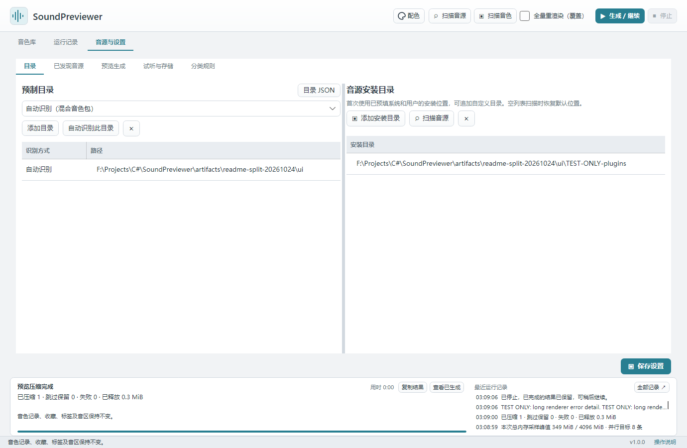
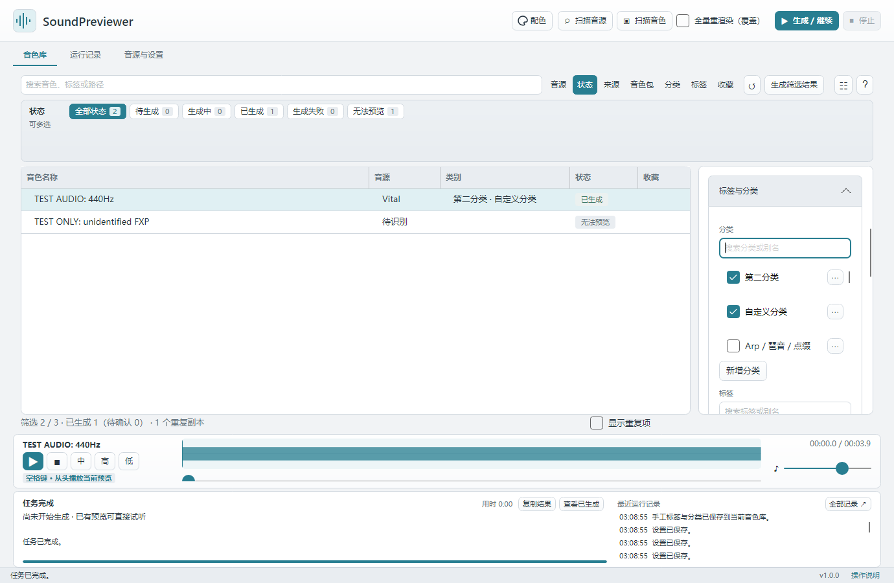

# Library organization

[简体中文（默认）](../library.md) · **English**

On this page:

- [Folders and scanning](#directories)
- [Search and multiple filters](#filters)
- [Categories, tags, and favorites](#metadata)
- [Locate files and use paths in a DAW](#daw)

## Folders and scanning

Add preset folders under **Synths and settings → Folders**. Mixed collections can use automatic synth detection without splitting folders first; you may also assign a specific synth. Click **Scan presets**. The list shows names, synths, categories, and statuses. Original preset files are read without modification.

Source options show each path's total records, unique records, duplicates within that source, and identical presets across sources. Cross-source counts include the source holding the primary record. These scan totals do not change with search. With **Show duplicates** off, only each group's retained record is displayed; a source containing only copies may have no matching visible records. Enable the switch to inspect other paths. Generation still shares the primary record's cache.

Preset sources and plugin folders are stored in **`Config/directories.json`** beside the EXE on Windows / Portable or beside the `.app` on Mac. Library location records and personal category rules also live under Config. Legacy root JSON and rules under Preview migrate compatibly while retaining originals; existing Config takes precedence. Initial setup exports old settings if available; subsequent starts read this file. Changes in the Folders page save to it.

Use the directory JSON button to open the file, close the app before editing, then restart. Preserve `FormatVersion` and existing source `Id` values. Editable fields include `Path`, `Synth`, `AutoDetect`, `Enabled`, and `PluginDirectories`; synth identifiers are `Vital`, `Serum1`, `Serum2`, `Sylenth1`, and `Spire`. Comments and trailing commas are accepted. Relative paths resolve against the program folder. Invalid files are reported and preserved. Restart after external changes before saving through the UI.

## Search and multiple filters

Search matches names, tags, paths, or MD5. Beside search are **Synth / Status / Source / Package / Categories / Tags / Fav.** tabs. A tab displays its options in a fixed three-row area, with scrolling for more items; the list and details stay in place.

**Click directly to select multiple options; no Ctrl or Shift is needed.** Click again to deselect. All clears the current group, and the tab count shows selected options. Options in one group use OR; groups use AND. For example, Vital + Serum 1 and Favorites shows favorites from either synth. Switching tabs keeps other selections. **↺** clears all filters.

Counts appear beside all options, including All and zero-result options. They account for search, other groups, and Show duplicates, but ignore selections within their own group. After selecting Serum 1, the Tags counts describe matching Serum 1 presets. A preset may have several tags or categories, so adding these counts can exceed the library total.

Source scan totals remain separate from visible result counts. With Show duplicates off, no search, source, status, package, category, tag, or favorite condition brings hidden copies back. Turn it on to inspect matching additional paths.

## Categories, tags, and favorites

Select a preset and open **Edit tags and categories**. Search names or aliases and check existing options; scroll within the fixed-height list. Use **Add category / Add tag** to create an option, or **⋯** to edit a name and aliases. A name is required; optional aliases are comma-separated. For example, `Arp` with aliases `Arpeggio, Accent` displays as `Arp / Arpeggio / Accent`.

**Save changes** saves selections. Clearing every selection explicitly saves an empty manual override. Rescanning and automatic classification preserve manual choices; **Restore automatic** uses the latest automatic classification again. New presets start without tags, which you can use for mood or purpose. Synth, extension, and automatic category have their own fields. Existing custom tags, favorites, and like / dislike feedback remain local.

Default rules recognize `CHORD`, `CHORDS`, `CH_` / `CH01` prefixes, and the Chinese word for chord. Word and prefix boundaries avoid classifying unrelated words such as Chorus or Chart. Upgrades add Chord to default rules and retain a prior rules copy. Personal rules and manual categories are preserved.

## Locate files and use paths in a DAW

**Copy file path** copies the original preset's complete local path as plain text. For bank / package entries, it copies the containing bank / package path, since an unexported entry has no separate file path. A supported source file can be copied while it exists, even if the synth is unidentified or the old record said the source was missing. The button is unavailable when the actual file is missing or cannot be located. This does not move or modify the preset or copy preview audio.

**Locate preset file** selects the source in Explorer or Finder. For package and bank entries, locate the bank file and choose the entry inside its synth.

In FL Studio, first add the synth and load the original file through the synth or Wrapper menu. Paste the copied path if the file picker supports it. Copying a path does not create a track, load a plugin, or convert a preset into FL `.fst` format. Automatic creation / loading is planned for investigation first on Windows FL Studio, then FL Studio, Bitwig, and Live across Windows / Mac. See [DAW transfer boundaries](https://github.com/Reguluz/SoundPreviewer/blob/main/docs/daw-transfer.md).

Use [batch generation](rendering.md#scope) on filtered results. For metadata translations, see [language and appearance](appearance.md#catalogs).

---

[Home](index.md) · [Quick start](quick-start.md) · [Installation](installation.md) · [Synth setup](synths.md) · [Generation and playback](rendering.md) · [Library](library.md) · [Data and backup](storage.md) · [Language and appearance](appearance.md) · [Troubleshooting](troubleshooting.md)

Applies to SoundPreviewer 1.0.1. Text and screenshots work offline; external download and feedback links require internet access.
