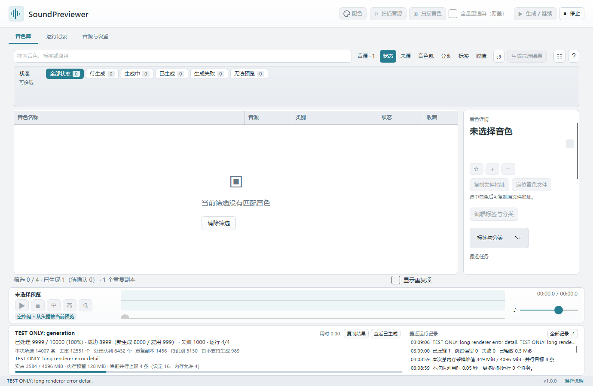

# Generation and playback

[简体中文（默认）](../rendering.md) · **English**

On this page:

- [Preview template](#template)
- [Generation scope](#scope)
- [Copy results and check loading](#verification)
- [Progress and stopping](#progress)
- [Player and shortcuts](#playback)
- [Five statuses](#status)
- [Concurrency and memory](#parallel)

## Preview template

Open **Synths and settings → Playback and storage**:

- Quick preview is enabled by default at **0.5 seconds per range**, adjustable from **0.1 to 4 seconds**.
- Low, Mid, and High default to **C2, C4, and C6** and can be changed independently. Use scientific note names such as `C4`, `C#4`, or `Db4`, from **C-1 to G9**. New previews play **Mid → High → Low**; each range can also be played separately.
- Disable quick preview to set key-hold and tail durations. For Vital, **Use Vital native settings** fills compatible settings.

Vital native rendering plays at velocity 89 with whole-second key holds. With quick preview disabled, its tail must be 30% of the hold duration. Quick preview extracts the configured duration from the actual native output.

Save settings to apply changes. Existing valid previews are retained; use **Regenerate this preset** when you want an existing preview to use the new template.

## Generation scope

Test one preset with **Regenerate this preset**, check all three ranges, then start a batch. Both **Generate / Resume** and **Generate filter** process only the current search and filter results. Valid previews are skipped; missing or invalid previews are generated. Filters remain selected after completion. Clear filters to process the whole library.

Processed totals include items skipped because requirements were not met or retry limits were reached; they do not mean every item generated successfully. **No rendering mode selected** means no path is configured. A configured but unavailable path retains its settings while reporting a specific path, version, environment, or format problem. Read the batch summary or the preset's latest result, fix the cause, and resume. Identical content at different paths shares valid previews.

## Copy results and check loading

**Copy results** in the bottom task area copies the full batch summary. **Copy render results** in a selected preset's details includes its name, source, synth version, and latest task description. Display ellipses do not truncate copied text. You can also select text in descriptions and the activity log.

If Serum reports suspected loading failure, its output closely resembled the startup sound without the target preset, so the preview was not saved. An older plugin version is one possible cause: open the preset in Serum and check its message. Sound similarity alone does not prove a version mismatch. When Serum 2 metadata and verified plugin state confirm a mismatch, the message explicitly requests a Serum 2 update and includes version information. Historical failure records receive the explanation without replacing original records or old previews.

## Progress and stopping

Progress shows processed items, successes split into new generation and reuse, failures, and skipped items for unconfigured / unavailable paths or retry limits. **Stop** retains finished results; the next run can continue. Initial generation may first prepare a startup reference and calibrate memory. Slow attacks can extend capture, so generation can take longer than the final short preview.

Progress, memory information, and recent activity stay below the player. Hover over long messages or open **Full log**. Starting, stopping, and long errors do not shift the preset list.

The library count and the current task queue are separate. For example, 14,007 selected records minus 1,456 duplicates gives 12,551 unique items. Excluding 5,130 unidentified items and 989 unsupported formats / bank entries leaves 6,432 queue items. The queue also includes reuse and items skipped for unmet requirements. Its denominator is not the whole library's unique count.

The denominator in **Running 1/1** is the currently usable concurrency limit. Configured and memory-permitted limits are shown separately. For example, a setting of 8 with memory for 3 still runs at 1 if simultaneous rendering is disabled for that synth. Initial measurements, reference preparation, and the remaining queue can also reduce concurrency. Same-synth concurrency is enabled by default but remains subject to memory estimates and limits.

The app prefers consecutive work on the same synth. When parallel instances are allowed, they run together; otherwise another synth can fill an idle slot. Each preset still loads its own plugin instance.

## Player and shortcuts

Select a preset and press **Space** to play its preview from the beginning. Press again while playing to restart. Holding Space does not repeatedly restart playback, and text fields / filter controls retain their normal Space behavior. The player includes a shortcut hint, play / stop buttons, separate **Mid / High / Low** buttons, a seek control, and a volume slider.

## Five statuses

| Status | Meaning and action |
| --- | --- |
| Pending | No usable preview yet; configure the synth and click Generate / Resume |
| Generating | Generation is in progress; stopping retains finished work |
| Generated | A playable preview exists; the details explain confirmation requirements or a failed later regeneration |
| Generation failed | The last attempt failed and no usable older preview exists; read the reason |
| Unavailable | Unsupported format, invalid file, missing source, or unconfirmed synth; the details explain what to do |

Always check the sound and external resources. Previews requiring confirmation keep **Confirm this preview matches the preset** in the details panel. Existing confirmations and caches remain compatible. Duplicates have a separate display switch and details rather than another status.

## Concurrency and memory

Set concurrency under **Synths and settings → Preview generation**. A fresh setup defaults to **Automatic**, or you can choose **1 / 2 / 4 / 8 / 16**. Automatic chooses a tier from physical cores, preferring 4 for four cores, and then limits it using memory use. Simultaneous rendering is enabled per synth by default. An explicitly disabled setting remains disabled after updating or relinking. Generate one Vital preset first after installation or a Vital update.

The memory budget is **1–16 GiB**, default **4 GiB**, across the app and rendering descendants. Saved changes apply to the next batch, including manual reference preparation. New tasks pause with 256 MiB reserved; actual usage above the budget stops the batch while keeping finished previews. For a 16 GiB budget, the admission threshold is 15.75 GiB. Each synth is calibrated singly; admission considers measured usage and predicted reservation, so the app need not fill the budget or reach the configured concurrency. Brief plugin allocations may exceed sampling intervals; this is not an OS-enforced hard quota.

*Example library and values. See [synth setup](synths.md#backend), [filter rules](library.md#filters), and [WAV compression](storage.md#compression).*

---

[Home](index.md) · [Quick start](quick-start.md) · [Installation](installation.md) · [Synth setup](synths.md) · [Generation and playback](rendering.md) · [Library](library.md) · [Data and backup](storage.md) · [Language and appearance](appearance.md) · [Troubleshooting](troubleshooting.md)

Applies to SoundPreviewer 1.0.1. Text and screenshots work offline; external download and feedback links require internet access.
