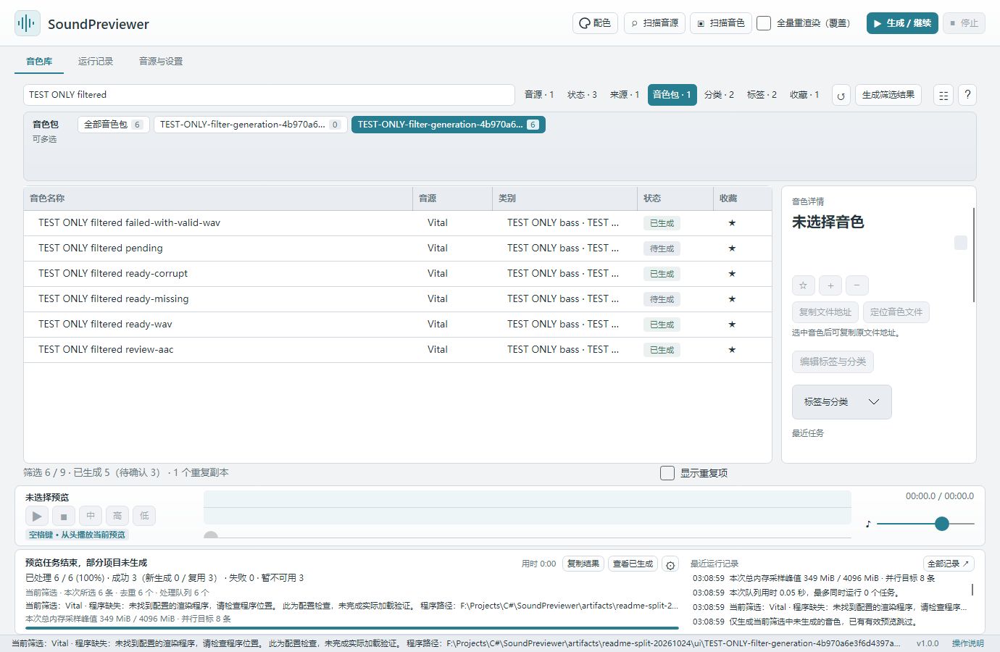

# Troubleshooting

[简体中文（默认）](../troubleshooting.md) · **English**

To check whether a feature exists, start with [Feature Q&A](quick-start.md#faq). This page covers scanning, generation, playback, and data recovery problems.

On this page:

- [Find the failing step](#rendering)
- [Messages and remedies](#messages)
- [Report a problem](#feedback)

## Find the failing step

1. **Synth not found:** add its installation folder under Synths and settings → Folders, scan again, and select the version under Discovered synths. See [synth scanning](synths.md#scan).
2. **Presets not found:** check the preset folder and enabled source, then Scan presets. See [supported formats](synths.md#support).
3. **Generation fails:** select the preset and read its status and latest task description. Fix that specific cause, [check the rendering path](synths.md#backend), and retry [one preset](quick-start.md#test).
4. **No sound or the wrong sound:** check player / system volume, output device, plugin license, and resources. Audition Mid / High / Low separately and retain the result description.
5. **Records missing after an update:** preserve both installations, check [data recovery](storage.md#recovery), and then decide whether legacy import is needed.

## Messages and remedies

| Situation | What to do |
| --- | --- |
| Configured synth is temporarily unavailable | Read the exact reason in the batch summary or preset result. Correct its path, version, environment, or format. Existing settings remain available |
| Old-library copying appears on every startup | An already prepared Preview opens directly. Migration progress is expected only for real imports, moves, or external-audio migration. If it repeats every time, retain startup logs and report it |
| Synth is uncertain and the preset is Unavailable | Check and assign its synth in the details panel. Do not infer compatibility from a similar filename |
| Old Vital bank entries cannot generate | Scan again to run embedded-resource checks. Eligible entries can generate; otherwise follow the reason and export individual presets from Vital |
| FXB or Spire native files are Unavailable | They are indexed only. Export individual presets from FXB in its synth; Spire native generation awaits implementation |
| Generated sound does not match | Do not confirm it yet. Check plugin version, license, samples, and wavetables, and record the preset and error |
| Unsure about startup-sound loading checks | A reference of the synth's startup sound helps avoid saving a default sound after failed loading. Supported rendering paths normally prepare it automatically |
| Old records disappeared after updating | Check Preview beside the app and migration messages. Preserve old databases and original audio before deleting or replacing anything |
| Want to use a new preview template | Regenerate the selected preset, or enable **Rerender all (overwrite)** for the current filtered scope. The overwrite switch resets after the operation |

## Report a problem

**Copy results** in the bottom task area copies the complete batch summary. In a selected preset's details, **Copy render results** includes its preset, source, synth version, and latest task description. Display ellipses do not truncate clipboard content. Open **Full log** for complete activity.

Report to [GitHub Issues](https://github.com/Reguluz/SoundPreviewer/issues) with app version, OS and architecture, synth version, file format, and relevant activity-log errors. Commercial plugins, license files, and complete private libraries are not required.

*Example library and values. Return to [quick start](quick-start.md) or check the [five statuses](rendering.md#status).*

---

[Home](index.md) · [Quick start](quick-start.md) · [Installation](installation.md) · [Synth setup](synths.md) · [Generation and playback](rendering.md) · [Library](library.md) · [Data and backup](storage.md) · [Language and appearance](appearance.md) · [Troubleshooting](troubleshooting.md)

Applies to SoundPreviewer 1.0.1. Text and screenshots work offline; external download and feedback links require internet access.
