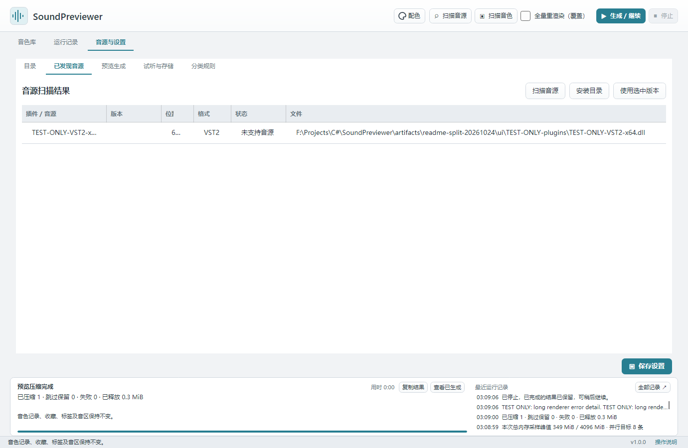
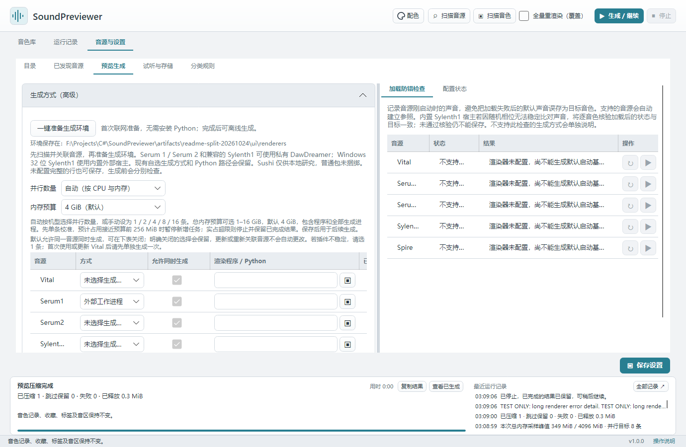

# 音源与生成环境

本页内容：

- [支持范围](#support)
- [计划支持的音源](#_1)
- [扫描并关联音源](#scan)
- [确认预览生成方式](#backend)
- [一键准备 DawDreamer](#environment)

## 支持范围

“可生成”表示已有生成方式，具体音源版本、授权和外部资源仍须在你的电脑上核对。Windows 与 Mac 共用操作界面；安装包能启动与某个插件实际能生成声音是两项不同的检查。

| 音源 | 可生成预览的音色文件 | 生成前需要准备 | 已有真实样本验证 |
| --- | --- | --- | --- |
| **Vital** | 独立 `.vital`；通过内嵌资源检查的 `.vitalbank` 包内音色 | Windows / Mac 的 Vital 独立程序，使用「Vital 原生」 | Windows 历史样本及 Vital 1.6.4 的两条包内音色；Apple Silicon 已验证独立测试音色，包内生成尚待实机验证 |
| **Serum 1** | 独立 `.fxp` | VST2 插件及一键准备的 DawDreamer 环境 | Windows Serum 1.334 x64；历史五音色并行实测见[并行说明](https://github.com/Reguluz/SoundPreviewer/blob/main/docs/parallel-rendering.md#060-windows-五样本实测2026-10-20)；Mac 尚待真实插件验证 |
| **Serum 2** | 原生 `.SerumPreset` | VST3 插件及带 Serum 2 依赖的 DawDreamer 环境 | Apple Silicon / Serum 2 2.0.23 的两个工厂音色；Windows、Intel Mac 尚待真实插件验证 |
| **Sylenth1** | 独立 `.fxp` | Windows x86 插件可用随包宿主；其他匹配架构的 VST2 需 DawDreamer | Windows Sylenth1 2.2.1.2 x86；五个音色完成 1 / 2 / 4 条实测，其他组合尚待验证 |
| **Spire** | 暂不生成 | 可扫描 `.spf`、`.spf2`、`.sbf`、`.swzip`，保留记录并显示「无法预览」 | 尚无真实插件生成验证 |

Vital 音色包请先重新「扫描音色」：内嵌波表和采样完整、资源格式已覆盖的条目会变为「待生成」，可直接使用「Vital 原生」生成。程序只读取所选条目，在当前生成任务的私有临时目录内加载，不导入或更改 Vital 全局资源目录。资源不完整或使用尚未覆盖的类型时，显示「无法预览」并给出具体原因；可在 Vital 中导入后导出独立 `.vital`，再扫描导出目录。音色包最大 256 MiB，包内独立预制最大 16 MiB。

`.fxb` 银行及其他尚未支持的银行内容仍**不能直接生成预览**，请先在对应音源中导出独立音色，再添加其目录。Serum 2 的旧 `.fxp` 需在 Serum 2 中导入并另存为 `.SerumPreset`，直接改扩展名无效。无法可靠判断归属的文件会显示「无法预览」，详情提示核对并指定所属音源。

更多版本与样本记录见 [音源验证记录](https://github.com/Reguluz/SoundPreviewer/blob/main/docs/rendering.md#本机验证记录)。这些样本不代表所有音色、插件版本或外部采样资源都已验证。

## 计划支持的音源

**Spire 原生预览生成**：目前已建立专用格式的扫描与索引，后续需验证真实插件加载、音色槽位与依赖资源，完成后才开放生成。其他新增音源尚无确定排期；FXB 银行槽位遍历也仍待实现。现阶段请按上表选择已有生成方式。

## 扫描并关联音源

点击顶部「扫描音源」，在「音源与设置 → 已发现音源」查看结果。程序会从常见安装位置查找；找不到时，在「目录」页添加音源安装目录后重新扫描。

可选中正确的插件版本，点击「使用选中版本」。优先使用与本机架构匹配的插件。扫描到插件后，还需确认下一步的生成方式；扫描本身不会演奏音色。

## 确认预览生成方式

在「音源与设置 → 预览生成」检查配置：

- **Vital**：选择 Vital 独立程序，方式为「Vital 原生」。只有 VST 插件文件时，不能直接使用这条原生路径。
- **Windows 的 Sylenth1 x86**：匹配后可使用随包的独立宿主。如果提示缺少运行库，请从 [Microsoft 官方页面](https://learn.microsoft.com/en-us/cpp/windows/latest-supported-vc-redist/) 安装 VC++ **x86** 运行库。
- **Serum 1 / Serum 2 / 使用 DawDreamer 的 Sylenth1**：点击本页「一键准备生成环境」，首次联网下载，成功后自动填入私有环境路径；再核对关联的插件文件。

检查音源的实际版本，点击「保存设置」。私有环境与当前程序架构一致；Windows 的 DawDreamer 路径使用 x64，不能加载 x86 插件。

「渲染程序」与「已关联插件」是两个位置：Serum 1 的 DawDreamer 方式应选择 Python 程序，插件则选择 64 位 `Serum_x64.dll`，不能把 DLL 当作 Python。未配好的音源也能先保存，不会挡住其他设置；「配置状态」会分别说明缺少什么。若已在本程序的 `Preview/renderers` 准备默认环境，空白的 DawDreamer 程序路径会自动填入；自选和暂时离线的路径会保留。

**Sushi（本地研究）**：保留手动配置入口，安装包不包含该宿主，也不自动切换。已有实验的适用范围及构建入口见[研究记录](https://github.com/Reguluz/SoundPreviewer/blob/main/docs/headless-host-research.md)。日常公开测试采用上面的私有 DawDreamer 环境。

「加载防错检查」通常自动进行。内置 Windows x86 Sylenth1 宿主遇到启动声音随机波动时，可改用逐音色的精确状态回读；状态与目标不一致或无法核验时仍拒绝保存。这不表示声音比对已稳定，生成结果仍需试听确认。Vital 原生方式不支持这项声音参照检查，也不会因此被禁止生成。

Sylenth1 的加载状态需要可核验。若提示“状态完全未变”或回读格式不同，当前插件未能提供可核验的加载结果；请使用匹配版本的 Sylenth1，或在对应版本中重新导出独立 FXP。这类明确不兼容的加载不会在同一次队列中重复尝试。

并行和内存配置见[生成与试听](rendering.md#parallel)。

## 一键准备 DawDreamer

仅使用 Vital 原生或 Windows 随包的 Sylenth1 x86 宿主时，可以跳过本节。

打开「音源与设置 → 预览生成」，点击 **「一键准备生成环境」**。无需了解 Python，也无需单独安装 Python 或 uv。首次需要联网，完成后可离线生成；Serum 2 所需组件也会一并准备。下载或检查失败时保留已有环境和缓存，可稍后重试。

程序只随包携带下载工具 uv；Python、DawDreamer 和下载缓存保存在程序旁的 **`Preview/renderers`**。不修改系统 PATH、Python 注册信息或用户的 uv / Python 配置。Windows 所需的 x64 C++ 运行库使用私有副本，无需为这条生成路径另装运行库。

成功后会自动补齐未配置且已发现匹配插件的音源，并修复本程序私有环境的失效旧路径；已有自选生成方式和可用的旧 Python 环境保留。未扫描到插件时，请先扫描音源，再选择版本。准备过程只检查空宿主，不安装商业插件，也不代表所有音色已通过验证。

也可以先准备环境，再扫描或关联插件；程序会为已确认兼容的插件补齐生成方式，已有自选宿主保持原样。

关闭程序后，可把整个程序目录连同 **Preview 与 Config** 一起移动；新私有环境使用相对清单，重开时自动定位。原音色文件、插件以及以前手动配置的外部环境仍需核对实际路径。命令行与高级参数见 [生成环境说明](https://github.com/Reguluz/SoundPreviewer/blob/main/docs/rendering.md#可选-dawdreamer-宿主)。

*选择已发现的音源版本并关联。点击图片可查看原图。截图使用示例音色库，名称、路径及数值仅用于演示。*

*核对生成方式、程序和插件路径。点击图片可查看原图。截图使用示例音色库，名称、路径及数值仅用于演示。*

保存设置后按[快速开始的单音色测试](quick-start.md#test)检查实际输出；配置状态或加载失败说明见[常见问题](troubleshooting.md#rendering)。

---

[操作说明首页](index.md) · [快速开始](quick-start.md) · [安装与启动](installation.md) · [音源配置](synths.md) · [生成与试听](rendering.md) · [音色库整理](library.md) · [数据维护](storage.md) · [语言与外观](appearance.md) · [常见问题](troubleshooting.md)

适用于 SoundPreviewer 1.0.0。正文和截图可离线阅读，外部下载与反馈链接需要联网。
