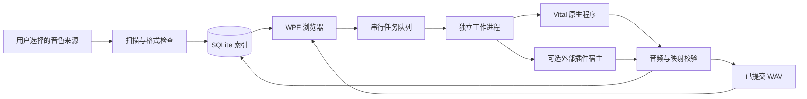

# SoundPreviewer 架构

更新日期：2026-10-12。项目依据 [项目计划](项目计划.md)，按照用户要求采用 C#、.NET 8 与 WPF 实现 Windows 桌面应用。原规划中的 Python / PySide6 是候选方案；当前 Python 限于可选插件宿主适配器。

当前交付包含可运行的音色库界面、索引、任务调度与渲染协议。真实合成器加载和演奏仍需逐版本验收；能够编译、通过基础设施测试或识别预制文件，都不能证明插件兼容。

## 项目职责

| 项目 / 目录 | 职责 |
| --- | --- |
| `SoundPreviewer.App` | WPF 音色列表、搜索与筛选、收藏和反馈、设置、任务控制、波形和本地播放、来源映射导出 |
| `SoundPreviewer.Core/Models` | 预制身份、来源、插件配置、试听模板、任务状态、音频指标、音区映射和 JSON 协议 |
| `SoundPreviewer.Core/Scanning` | 递归发现、格式检查、SHA256 变更检测、MD5 重复索引、来源重叠去重、银行条目索引 |
| `PluginScanService` / `PluginSelectionService` | 共享安装目录的只读 PE / 元数据 / 导出检查、位数与 VST3 包识别、已核对产品关联与版本选择 |
| `SoundPreviewer.Core/Storage` | Windows SQLite 参数绑定、事务、版本化数据库、完整 JSON 元数据与设置 |
| `SoundPreviewer.Core/Services` | 串行渲染队列、进度、取消、有限重试、缓存与存储预算 |
| `SoundPreviewer.Core/Audio` | 工作进程调用、进程生命周期、WAV 校验与指标、拼接与重采样、WinMM 本地试听 |
| `SoundPreviewer.Worker` | 独立进程内执行 Vital 原生适配器，或转交实现协议的外部插件宿主 |
| `scripts/renderers/dawdreamer_worker.py` | 可选 Python 宿主，用 DawDreamer 验证匹配架构的 VST2 单预制；发布时复制到工作进程的 `Renderers` 目录 |
| `tests/SoundPreviewer.Tests` | 无外部测试框架的回归检查；测试音频与测试工作进程只验证基础设施 |

浏览与播放读取已生成音频，不实例化插件。音色扫描、音频读取和渲染任务在后台运行，界面展示进度与结果。

试听使用 Windows `waveOut`，支持播放、暂停、继续、音区定位、拖动位置和独立音量。原始 WAV 解码后在内存转换为 PCM16 播放，原文件保留不变。此实现不依赖本机未安装的 Windows Media Player 可选组件。

## 身份与来源

明确指定音源的来源沿用音源种类、规范化源文件路径、包内路径和可选银行槽位生成的身份。自动识别来源以物理文件与包内位置保持身份，后续自动纠正或手动指定音源不改变已有记录 ID。名称用于展示与搜索，重复名称不会合并不同文件。`SourceFolder.AutoDetect` 默认关闭，使旧版设置继续按指定音源扫描；新增混合目录可开启自动识别。

自动识别采用独有扩展名：`.vital` / `.vitalbank` 属于 Vital，`.SerumPreset` 属于 Serum 2。共享 VST 格式只接受已核对的完整文件头产品 ID：`XfsX` 为 Serum 家族、`syl1` 为 Sylenth1。已核对的产品 ID 优先于误放的目录名称，并在 `DetectionReason` 中保留冲突说明；最近且在配置根目录以内的完整目录词可将 Serum 家族细分为 Serum 2。未知 / 缺失产品 ID、版本词冲突和不可靠共享格式进入 `Unknown` / `Unidentified`，不根据子字符串、文件名或共用扩展名猜测可渲染音源。

明确音源的目录优先于重叠的自动识别目录。`ScanService.AssignSynth` 保持记录 ID、收藏、反馈与个人标签，记录手动分类；音源变化时清除预览元数据、缓存和重试历史。此分类随后续扫描保存，不会被目录或文件头重新覆盖；银行仍保持不支持渲染。识别依据与标签持久化供界面检索和核对，识别归属不构成插件实际加载验收。

每次扫描在同一次读取中计算支持源文件的 SHA256 与 MD5，能够发现文件大小与修改时间均未变化的内容修改。相同身份内容变更后，收藏、喜欢 / 不喜欢反馈、个人标签和手动分类保留，旧预览元数据与重试计数失效；SHA256 未变化的旧记录也会回填 MD5。重叠来源按身份去重；关闭、不可访问或未能完整扫描的来源不会使已有记录被误判为丢失。扫描跳过重解析点，不跟随目录链接。

`ContentMd5` 保存完整物理源文件的 MD5。`PresetIndex.RebuildDuplicates` 按 MD5、音源、区分大小写的包内路径和银行槽位分组，保留所有路径记录，只通过 `DuplicateOfId` 指向代表项。默认浏览与队列隐藏副本，不删除用户文件、收藏或反馈。代表优先选择启用且可访问来源，再考虑完整有效预览和个人反馈；失踪代表会被可用副本替代。复用旧代表音频还须匹配 SHA256、通过 WAV、保存模板与三音区映射检查，保留新代表自己的来源和反馈，并标为待确认。MD5 用于索引去重，不取代 SHA256 和实际渲染验证。

Vital `.vital` 检查 JSON 和 `settings` 对象。`.vitalbank` 只读取 ZIP，保留 `.vital` 条目的内部路径，指纹同时包含整个包的哈希，以覆盖包内资源变更。它不解压资源、不宣称条目可直接加载，并标记为 `Unsupported`。Sylenth1 `.fxb` 记录为不透明银行，不根据文件名或推测数量伪造槽位。FXP 检查 VST 文件头；该检查不能确认实际插件产品或授权。

独立预制引用的外部采样、波表与相对资源还没有完整的依赖清单；这些资源的变化尚不能全部自动使缓存失效。真实加载检查和资源验收属于后续适配工作。

## 插件目录

`AppSettings.PluginDirectories` 保存共享安装目录，`DiscoveredPlugins` 保存可核对的发现结果；旧设置默认为空，不改变既有插件配置。扫描 `.dll`、`.vst3` 文件 / 包和 Vital 独立程序，只读取 PE 架构、版本资源及 VST 入口导出，不执行插件。VST3 包分别保存用户选择的外层路径与内部实际二进制路径。无必要导出的普通 DLL 不作为插件，已知 SerumFX 效果器不作为乐器；只有产品元数据与结构证据相符时才关联实际音源，否则候选保持 `Unknown`。

自动关联仅选择已识别的 x64 候选，按当前格式偏好与版本排序，保留仍有效的用户 DLL / VST3 包选择。Vital 独立程序只能自动填入未配置或原生后端；已有外部渲染程序不能被扫描替换。插件路径、发现版本与「预览渲染器（高级）」中的宿主程序是不同字段。手动选择版本仍须满足宿主位数和格式，发现或关联成功不代表实际插件可渲染。

显式从 Vital 原生切换至 VST 会清除 CLI 程序及其指纹，将后端转为未配置；显式选回独立程序会恢复原生后端，清除旧 VST 路径及指纹，避免版本记录与实际执行的程序不一致。

## 存储与缓存

默认数据目录为 `%LOCALAPPDATA%\SoundPreviewer`，也可通过启动参数指定独立目录。数据库为 `library.db`，预览目录可配置，运行日志为 `application.log`。应用保留原预制文件，预览存入独立目录。

数据库使用 Windows 提供的 `winsqlite3.dll`，采用 UTF8 参数绑定、WAL 和事务。`user_version` 标记数据库结构版本；v2 在 v1 基础上增补 MD5、重复代表列和索引，保留旧记录与设置。预制与设置以完整 JSON 保存，另有身份、来源、状态和反馈列供索引使用。`FindByMd5` 验证十六进制输入并进行参数绑定、大小写不敏感的索引检索。收藏、反馈时间、渲染模板、插件版本、实际音区时长及指标均随记录持久化。

新生成的缓存键结合预制内容、银行身份、音源配置、可执行文件与插件文件哈希、试听模板和适配器版本；VST3 包的插件指纹包括已发现的实际内部二进制。默认生成先根据记录保存的模板校验已有 WAV、采样率、适配器版本与完整三音区映射，在当前插件配置检查和重试限制之前跳过有效预览。因此模板或插件配置变化不会自动重渲染；`forceRegenerate` 显式跳过复用，源内容与归属变更仍由扫描失效旧映射。分析模型尚未接入；未来模型版本变化应只重算分析结果，不使真实预览音频无故重渲染。

任务先在最终预览目录的同卷私有目录写入请求、结果与 WAV。桌面端完成音频和映射校验后，再移动音频到最终缓存路径，避免将半成品当作已完成预览。每项提交立即持久化后再进入下一项；停止会结束当前进程树，无旧有效预览的当前项转为待处理并撤回本次尝试计数，已完成与未触及项保留。强制生成仅在当前项开始时备份其旧有效映射，取消或失败恢复该映射，不预先清空整个音色库。

音频提交与数据库提交不属于同一事务；启动恢复发现中断任务时，完整有效旧 WAV、保存模板和三音区映射可保留并转为待确认，否则转回待处理并清空无效派生映射，原尝试历史保留。已经生成但尚未索引的文件可能保留，自动清理策略尚未实现。

## 渲染与校验

默认串行执行，一个任务调用一个工作进程。进程通过 JSON 的 `RenderRequest` / `RenderResult` 协议交换来源、插件、模板、目标路径、音区映射和结果。Windows Job Object 用于超时、取消和退出时结束进程树。详细参数与实际限制见 [渲染后端说明](rendering.md)。

Vital 原生路径实现了三次单音渲染、音频拼接和实际演奏参数记录，但原生 CLI 没有可依赖的预制加载成功反馈。因此原生渲染结果进入待确认状态，须人工检查音色对应关系与外部资源。

Serum / Sylenth1 通过可选外部宿主协议接入。DawDreamer 后端使用用户指定的 Python 和插件路径，面向 Serum 1 / Sylenth1 的独立 FXP、VST2 和 x64 组合；x86 插件、Serum 2 专有预制和银行不据此视为支持。适配脚本固定 DawDreamer 0.8.3 / NumPy 1.26.4，其安装、插件授权与加载接口均需单独核对。第三方宿主或示例项目宣称的支持不计入本项目的兼容矩阵。当前没有完成真实插件渲染验收。

WAV 校验检查格式、帧边界、采样率、长度、非有限值与三音区时间范围。峰值、RMS、过零率及每音区指标用于排查静音和接近削波的输出；它们不是完整音色特征、模型向量或偏好评分。静音与削波线索进入待确认，异常值、截断文件或无效映射不提交。

## 扩展边界

本版本没有 EfficientAT / CLAP、相似音色搜索、参考歌曲导入、个人推荐训练、OCR / 视觉加载流程或自定义 MIDI 模板。收藏和反馈作为真实用户数据保留，可供后续本地分析使用。

当前 WPF、Windows SQLite 调用和进程管理均依赖 Windows，Core 的目标框架也包含 Windows 限制。macOS 可以复用数据结构、规则设计与协议，但不能直接运行现有桌面程序；需要另行实现界面、SQLite 和进程管理适配，并验证 Apple Silicon / Intel 插件及打包。

构建基础项目不使用第三方 NuGet 包。商业音源、用户音色包、Python 宿主依赖和模型权重不随当前应用捆绑。发布前还需核对所选宿主、源码、SDK、模型及素材的实际版本和再分发许可。
