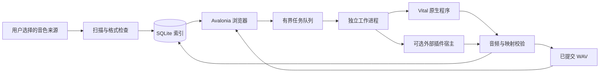

# SoundPreviewer 架构

更新日期：2026-10-19，当前为 0.5.0 开发版。项目依据 [项目计划](项目计划.md)，采用 C#、.NET 8 与 Avalonia 实现 Windows / macOS 共用桌面应用。原规划中的 Python / PySide6 是候选方案；当前 Python 限于可选插件宿主适配器。直接在 `main` 开发；patch 用于小修，minor 用于较大功能，major 须用户明确确认。`version-policy.json` 与 CI 限制批准的 major，`0.x` 发布始终为 prerelease。

当前交付包含可运行的音色库界面、索引、任务调度与渲染协议。真实合成器加载和演奏仍需逐版本验收；能够编译、通过基础设施测试或识别预制文件，都不能证明插件兼容。

## 项目职责

| 项目 / 目录 | 职责 |
| --- | --- |
| `SoundPreviewer.App` | Avalonia 共用音色列表、搜索与筛选、收藏和反馈、设置、任务控制、波形和本地播放、来源映射导出 |
| `SoundPreviewer.Core/Models` | 预制身份、来源、插件配置、试听模板、任务状态、音频指标、音区映射和 JSON 协议 |
| `SoundPreviewer.Core/Scanning` | 递归发现、格式检查、SHA256 变更检测、MD5 重复索引、来源重叠去重、银行条目索引 |
| `PluginScanService` / `PluginSelectionService` | 共享安装目录的只读 PE / 元数据 / 导出检查、位数与 VST3 包识别、已核对产品关联与版本选择 |
| `SoundPreviewer.Core/Storage` | 跨平台系统 SQLite 参数绑定、事务、版本化数据库、完整 JSON 元数据与设置 |
| `SoundPreviewer.Core/Services` | 有界渲染队列、进度、取消、有限重试、缓存与存储预算 |
| `PresetCategoryService` | 有界 JSON 名称分类规则、完整词 / 前缀匹配、独立 `CategoryTags` 与重新应用 |
| `PresetMetadataService` | 手工标签 / 分类、明确清空、恢复自动结果与旧有效字段兼容 |
| `PreviewStorageService` | 统一库目录迁移、SQLite 一致快照、音频路径重写和有界缓存清理 |
| `InitBaselineService` / `InitAudioComparer` | 无预制加载的启动基准、版本与模板身份校验、提交前的三音区严格近似比对 |
| `SoundPreviewer.Core/Audio` | 工作进程调用、进程生命周期、WAV 校验与指标、拼接与重采样、WinMM / AudioQueue 本地试听 |
| `QuickPreviewAudio` | 双声道短窗响度检测、按 0.1–4 秒目标裁剪、边界静音压缩和淡化；默认每音 0.5 秒 |
| `SoundPreviewer.Worker` | 独立进程内执行 Vital 原生适配器，或转交实现协议的外部插件宿主 |
| `SoundPreviewer.Vst2Host` | 可选独立 x86 .NET 8 / VST.NET 进程，加载 Sylenth1 VST2 独立 FXP；不加入基础解决方案 |
| `scripts/renderers/dawdreamer_worker.py` | 可选 Python 宿主，用 DawDreamer 验证匹配架构的 VST2 单预制；发布时复制到工作进程的 `Renderers` 目录 |
| `tests/SoundPreviewer.Tests` | 无外部测试框架的回归检查；测试音频与测试工作进程只验证基础设施 |

浏览与播放读取已生成音频，不实例化插件。音色扫描、音频读取和渲染任务在后台运行，界面展示进度与结果。

试听使用 Windows `waveOut` 或 macOS `AudioQueue`，支持播放、暂停、继续、音区定位、拖动位置和独立音量。原始 WAV 解码后在内存转换为 PCM16 播放，原文件保留不变。此实现不依赖本机未安装的 Windows Media Player 可选组件。

新 `PreviewTemplate` 默认 `NoteOrder=MiddleHighLow`，即中 → 高 → 低；`Pitches` 决定实际采集、拼接和 Notes 校验顺序。缺字段的旧 JSON 回退到 `LowMiddleHigh=0`，已生成音频按保存模板及真实 MIDI 映射播放和复用，不自动重排文件。顺序作为模板的一部分进入新缓存和启动基准身份。

界面以 C2 / C4 / C6 显示默认低 / 中 / 高音，协议仍保存 MIDI 36 / 60 / 84。`QuickPreviewSeconds` 默认 0.5、范围 0.1–4 秒；缺字段的旧模板仍解释为 0.5。默认值不额外改变旧缓存键；非默认快速时长参与新模板身份，实际裁剪与捕获上限按目标时长校验。

## 界面与分类

主音色表是唯一的逐音色任务视图，包含类别、尝试次数、最近任务结果 / 原因、生成时间、音源与适配器版本等可选列。列菜单更改可见性，横向滚动保留长字段；运行记录页不再复制音色表。`LastRenderOutcome` / `LastRenderMessage` 与可试听预览状态分开，因而强制生成失败但仍有旧 `Ready` / `NeedsReview` 预览时，仍可被「最近生成失败」查出。

搜索、音源、状态、来源、包、类别、标签及收藏条件以 AND 组合。来源使用来源 ID，类别与标签匹配完整条目，空值选项与「全部」分开。「生成筛选结果」读取当前视图并使用默认复用规则；主生成入口和显式全量覆盖仍使用全库代表项。清除筛选与查看已生成会一并重置新增条件。

设置采用五个内部子页：「目录」「已发现音源」「预览生成」「试听与存储」「分类规则」。「预览生成」将高级生成方式与「加载防错检查」横向组织，列表使用剩余高度和独立滚动，保留可调整的分隔条。设置页隐藏主播放台和闲置任务带，运行时保留任务进度；分类页仅显示规则专用保存入口。

库目录内的 `Config/preset-categories.json` 是可编辑的名称分类规则，首次缺失才从默认规则建立，不覆盖现存文件。规则仅支持关键词与前缀，不执行脚本或正则表达式；限制大小、深度和条目长度，失败保留上一份有效规则。扫描与显式重新分类共用此服务，先分析全部名称，再更新自动分类；手工分类保持有效，不修改稳定 ID、收藏、反馈或音频映射。

`PresetRecord.ManualTags` / `ManualCategories` 为 nullable 列表：`null` 表示使用自动结果，空列表表示用户明确清空。首次编辑保存 `AutomaticTags` / `AutomaticCategories` 快照，此后扫描与规则重算更新快照，`PresetMetadataService.Reset*` 恢复最近的自动结果。`Tags` / `CategoryTags` 始终镜像有效内容供既有读取方使用；源内容变化时创建新扫描候选也保留覆盖、快照与未知 JSON 字段。扩展字段保存在 schema 2 的原 JSON 中，不另建标签文件或改变缓存身份。

界面重新分类在后台克隆记录、应用规则并事务持久化，成功后才在界面线程合并 `CategoryTags` 与刷新筛选选项。取消或写入失败不先改变可见记录，避免出现界面新分类与磁盘旧分类不同步。

## 身份与来源

明确指定音源的来源沿用音源种类、规范化源文件路径、包内路径和可选银行槽位生成的身份。自动识别来源以物理文件与包内位置保持身份，后续自动纠正或手动指定音源不改变已有记录 ID。名称用于展示与搜索，重复名称不会合并不同文件。`SourceFolder.AutoDetect` 默认关闭，使旧版设置继续按指定音源扫描；新增混合目录可开启自动识别。

自动识别采用独有扩展名：`.vital` / `.vitalbank` 属于 Vital，`.SerumPreset` 属于 Serum 2。共享 VST 格式只接受已核对的完整文件头产品 ID：`XfsX` 为 Serum 家族、`syl1` 为 Sylenth1。已核对的产品 ID 优先于误放的目录名称，并在 `DetectionReason` 中保留冲突说明；最近且在配置根目录以内的完整目录词可将 Serum 家族细分为 Serum 2。未知 / 缺失产品 ID、版本词冲突和不可靠共享格式进入 `Unknown` / `Unidentified`，不根据子字符串、文件名或共用扩展名猜测可渲染音源。

明确音源的目录优先于重叠的自动识别目录。`ScanService.AssignSynth` 保持记录 ID、收藏、反馈与个人标签，记录手动分类；音源变化时清除预览元数据、缓存和重试历史。此分类随后续扫描保存，不会被目录或文件头重新覆盖；银行仍保持不支持渲染。识别依据与标签持久化供界面检索和核对，识别归属不构成插件实际加载验收。

每次扫描在同一次读取中计算支持源文件的 SHA256 与 MD5，能够发现文件大小与修改时间均未变化的内容修改。相同身份内容变更后，收藏、喜欢 / 不喜欢反馈、个人标签和手动分类保留，旧预览元数据与重试计数失效；SHA256 未变化的旧记录也会回填 MD5。重叠来源按身份去重；关闭、不可访问或未能完整扫描的来源不会使已有记录被误判为丢失。扫描跳过重解析点，不跟随目录链接。

`ContentMd5` 保存完整物理源文件的 MD5。`PresetIndex.RebuildDuplicates` 按 MD5、音源、区分大小写的包内路径和银行槽位分组，保留所有路径记录，只通过 `DuplicateOfId` 指向代表项。默认浏览与队列隐藏副本，不删除用户文件、收藏或反馈。代表优先选择启用且可访问来源，再考虑完整有效预览和个人反馈；失踪代表会被可用副本替代。复用旧代表音频还须匹配 SHA256、通过 WAV、保存模板与三音区映射检查，保留新代表自己的来源和反馈，并标为待确认。MD5 用于索引去重，不取代 SHA256 和实际渲染验证。

Vital `.vital` 检查 JSON 和 `settings` 对象。`.vitalbank` 只读取 ZIP，保留 `.vital` 条目的内部路径，指纹同时包含整个包的哈希，以覆盖包内资源变更。它不解压资源、不宣称条目可直接加载，并标记为 `Unsupported`。Sylenth1 `.fxb` 记录为不透明银行，不根据文件名或推测数量伪造槽位。FXP 检查 VST 文件头；该检查不能确认实际插件产品或授权。

独立预制引用的外部采样、波表与相对资源还没有完整的依赖清单；这些资源的变化尚不能全部自动使缓存失效。真实加载检查和资源验收属于后续适配工作。

## 插件目录

`AppSettings.PluginDirectories` 保存共享安装目录，`DiscoveredPlugins` 保存可核对的发现结果；旧设置默认为空，不改变既有插件配置。扫描 `.dll`、`.vst3` 文件 / 包和 Vital 独立程序，只读取 PE 架构、版本资源及 VST 入口导出，不执行插件。VST3 包分别保存用户选择的外层路径与内部实际二进制路径。无必要导出的普通 DLL 不作为插件，已知 SerumFX 效果器不作为乐器；只有产品元数据与结构证据相符时才关联实际音源，否则候选保持 `Unknown`。

自动关联选择当前平台与架构兼容的已识别候选；若 Windows 发行目录带有独立 x86 宿主，也允许 Sylenth1 x86 VST2。按当前格式偏好与版本排序，保留仍有效的用户 DLL / VST3 包选择。Vital 独立程序只能自动填入未配置或原生后端；已有自定义外部渲染程序不能被扫描替换。插件路径、发现版本与「预览生成 → 生成方式（高级）」中的宿主程序是不同字段。手动选择版本仍须满足宿主位数和格式，发现或关联成功不代表实际插件可渲染。

显式从 Vital 原生切换至 VST 会清除 CLI 程序及其指纹，将后端转为未配置；显式选回独立程序会恢复原生后端，清除旧 VST 路径及指纹，避免版本记录与实际执行的程序不一致。

`PluginSelectionService.RefreshBundledHost` 只在当前发行带有可用内置宿主时，迁移 Sylenth1 / ExternalWorker 中文件名精确为 `SoundPreviewer.Vst2Host.exe`、父目录精确为 `Vst2Host-x86` 的旧路径（大小写不敏感）。迁移清除旧可执行文件指纹和基准定位，保留插件路径、指纹及实际版本；相同当前路径为幂等操作，自定义程序和其他配置不受影响。此步骤不执行插件。

## 存储与缓存

新库默认集中到 `ApplicationPaths.DefaultPreviewDirectory`：Windows 为程序目录下的 `Preview`，macOS 为 `.app` 旁的 `Preview`。`ApplicationDirectory` 仍指向实际程序与资源目录，`PortableApplicationDirectory` 用于可迁移数据位置。`library.db`、运行日志、缓存、加载防错参照、`Config` 与手工元数据保存在同一库根。可执行目录须可写，显式参数和已记住的旧库仍可覆盖默认路径。定位文件优先保存在程序旁，并以相对路径记录随程序移动的库；程序旁只读时可将小型定位文件写到原用户目录，数据本身不会静默改写到那里。详见[数据与升级](cross-platform.md#数据与升级)。

`PreviewStorageService.RelocateLibrary` 先建立包含已提交 WAL 页的 SQLite 快照，复制 `Config` 和必要音频并校验哈希，再在目标库中事务保存设置与路径。迁移模式保留试听与基准映射；清除模式迁移记录和规则、清空派生音频映射。旧数据库和 `Config` 保留作回滚备份，迁移前快照也存入新库 `Backups`。仅处理当前记录或基准明确引用、可确认独占且不经链接的缓存；旧共享目录、外部音频、源文件和未知音频 / 基准保留并报告，不凭哈希命名清理孤立文件。独立「清空预览」同样保留标签、分类、收藏与源记录，不递归删除库根，也不保证目录完全为空。

SQLite schema 0/1 升级前生成一致备份，备份或迁移失败即中止、回滚；schema 2 保持不变，未知更高结构拒绝打开。程序升级不单因应用版本改变缓存键，既有有效预览仍可复用。

数据库使用 Windows 提供的 `winsqlite3.dll` 或 macOS 提供的 `/usr/lib/libsqlite3.dylib`，采用 UTF8 参数绑定、WAL 和事务。`user_version` 标记数据库结构版本；v2 在 v1 基础上增补 MD5、重复代表列和索引，保留旧记录与设置。预制与设置以完整 JSON 保存，另有身份、来源、状态和反馈列供索引使用。`FindByMd5` 验证十六进制输入并进行参数绑定、大小写不敏感的索引检索。收藏、反馈时间、渲染模板、插件版本、实际音区时长及指标均随记录持久化。

新生成的缓存键结合预制内容、银行身份、音源配置、可执行文件与插件文件哈希、试听模板和适配器版本；VST3 包的插件指纹包括已发现的实际内部二进制。默认生成先根据记录保存的模板校验已有 WAV、采样率、适配器版本与完整三音区映射，在当前插件配置检查和重试限制之前跳过有效预览。因此模板或插件配置变化不会自动重渲染；`forceRegenerate` 显式跳过复用，源内容与归属变更仍由扫描失效旧映射。分析模型尚未接入；未来模型版本变化应只重算分析结果，不使真实预览音频无故重渲染。

任务先在最终预览目录的同卷私有目录写入请求、结果与 WAV。桌面端完成音频和映射校验后，再移动音频到最终缓存路径，避免将半成品当作已完成预览。每项提交立即持久化后再进入下一项；停止会结束当前进程树，无旧有效预览的当前项转为待处理并撤回本次尝试计数，已完成与未触及项保留。强制生成仅在当前项开始时备份其旧有效映射，取消或失败恢复该映射，不预先清空整个音色库。

音频提交与数据库提交不属于同一事务；启动恢复发现中断任务时，完整有效旧 WAV、保存模板和三音区映射可保留并转为待确认，否则转回待处理并清空无效派生映射，原尝试历史保留。已经生成但尚未索引的文件可能保留，自动清理策略尚未实现。

## 渲染与校验

默认串行执行，一个任务调用一个工作进程。进程通过 JSON 的 `RenderRequest` / `RenderResult` 协议交换来源、插件、模板、目标路径、音区映射和结果。Windows Job Object 和 macOS 独立进程组用于超时、取消和退出时结束渲染子进程。详细参数与实际限制见 [渲染后端说明](rendering.md)。

0.5.0 增加 `AppSettings.MaxParallelRenders`（1 或 2，缺字段默认 1）。全局 2 时不同音源可重叠；相同音源须显式启用 `PluginConfiguration.AllowParallelRendering`，缺字段默认 false，重新关联不同插件或版本会撤销许可。设置快照、同缓存键任务合并、单次声音参照准备、空间预留和集中提交由父进程协调，Worker 仍使用独立进程和新实例。调度设置不进入音频缓存或声音参照身份。停止会收束所有在飞任务，已完成的提交继续入库。详细验证见 [并行方案](parallel-rendering.md)。

Vital 原生路径实现了三次单音渲染、音频拼接和实际演奏参数记录，但原生 CLI 没有可依赖的预制加载成功反馈。因此原生渲染结果进入待确认状态，须人工检查音色对应关系与外部资源。

Serum / Sylenth1 通过可选外部宿主协议接入。DawDreamer 后端使用用户指定的 Python 和插件路径，支持匹配架构的 Serum 1 / Sylenth1 独立 VST2 FXP，以及 Serum 2 VST3 原生 `.SerumPreset` 的状态转换与加载回读；旧 FXP 不直接交给 Serum 2 VST3。独立 VST.NET 后端只适配 Sylenth1 x86 VST2 FXP。桥接固定 DawDreamer 0.8.3 / NumPy 1.26.4，提供运行库检查和空宿主自检。真实插件的历史样本、版本与人工确认边界保持在[渲染记录](rendering.md)，不能据第三方支持声明或测试通过扩大兼容范围。

WAV 校验检查格式、帧边界、采样率、长度、非有限值与三音区时间范围。峰值、RMS、过零率及每音区指标用于排查静音和接近削波的输出；它们不是完整音色特征、模型向量或偏好评分。静音与削波线索进入待确认，异常值、截断文件或无效映射不提交。

界面的「加载防错检查」在协议中仍使用 `RenderRequest.IsInitializationBaseline`：宿主建立新实例而不加载任何预制，记录启动声音，防止加载失败后将默认声音误存为目标音色。元数据绑定插件 / 宿主指纹、实际版本、模板和策略，保存独立 WAV 与音区映射。Serum 1 / Serum 2 / Sylenth1 的 DawDreamer 后端及内置 Sylenth1 x86 宿主提供该协议；Vital CLI 和未适配后端不提供此保护。自动建立参照通常不需用户手动操作；参照不稳定时明确失败，真实版本验收仍以历史样本记录为准。

历史 Windows 单样本记录：Serum 1.334 x64 / DawDreamer 与 Sylenth1 2.2.1.2 x86 / 内置宿主完成 v2 中高低顺序的自动检查，独立启动输出均命中 3/3 参考，正常 FXP 均为 0/3；两份正常音频低音量设备播放完成。该轮未覆盖批量或新的人工音色身份确认。Serum 1.334 x64 与 Sylenth1 2.2.1.2 x86 更早的各一个真实 FXP 已生成、播放，用户确认三音区正常；这两轮确认范围分别保留，不合并为更大兼容性结论。

可用基准对新输出执行三音区波形相关、包络、频谱与响度的多条件检查，不能仅凭名称或单一频谱判定。严格匹配默认启动声音的结果在原子移动前被拒绝，记录最近失败；旧有效预览不被覆盖。支持的后端若无法建立有效基准会明确失败，不静默降级为已启用保护。默认复用既有完整预览仍先于新基准流程，旧缓存不会被追溯宣称已通过此检查。详见 [基准支持与验收边界](rendering.md#默认启动音色基准)。

`startup-audio-comparison-v2` 使用三份独立原始参考，对三音区分别作受固定硬边界限制的漂移校准；参考两两不在硬边界内则失败，不产生可用保护。候选须整体匹配至少两份参考的全部三个音区，不能把不同参考中各自匹配的音区拼成通过结果。短于四分之一秒的参考只采用原严格比较，不扩大容差。

## 扩展边界

本版本没有 EfficientAT / CLAP、相似音色搜索、参考歌曲导入、个人推荐训练、OCR / 视觉加载流程或自定义 MIDI 模板。收藏和反馈作为真实用户数据保留，可供后续本地分析使用。

App、Core、Worker 与测试共同使用 `net8.0`。App 的 Avalonia XAML、事件处理与界面模型在两端共用；平台差异收敛在原生音频、SQLite 加载、插件元数据与进程隔离。可选 x86 VST.NET 宿主仍单独使用 Windows 目标，不进入 macOS 发布。详见 [双平台实现与验证](cross-platform.md)。

桌面界面使用 Avalonia、Fluent 主题和 DataGrid NuGet 包。商业音源、用户音色包、Python 宿主依赖和模型权重不随当前应用捆绑。发布前还需核对所选宿主、源码、SDK、模型及素材的实际版本和再分发许可。
